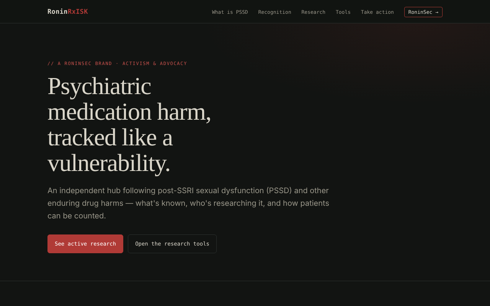
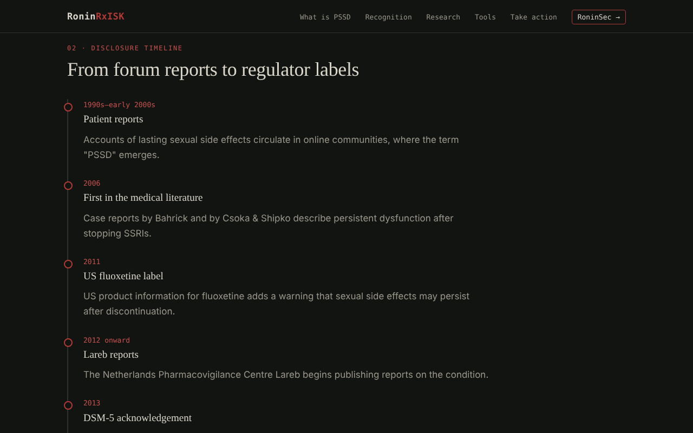
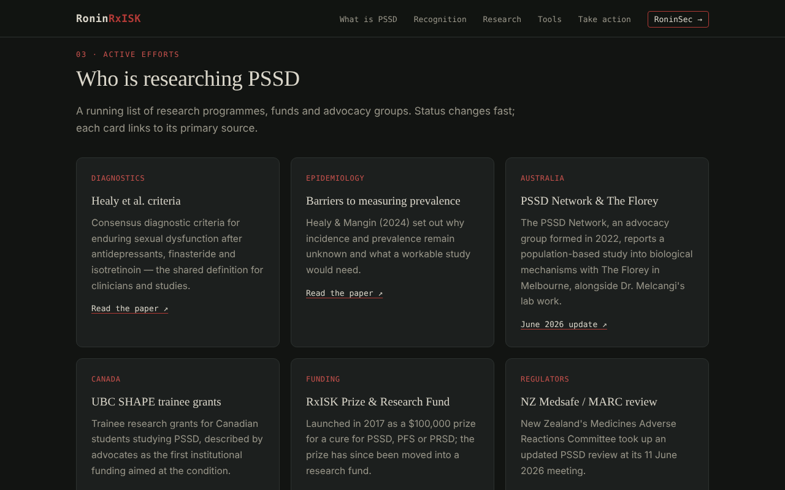
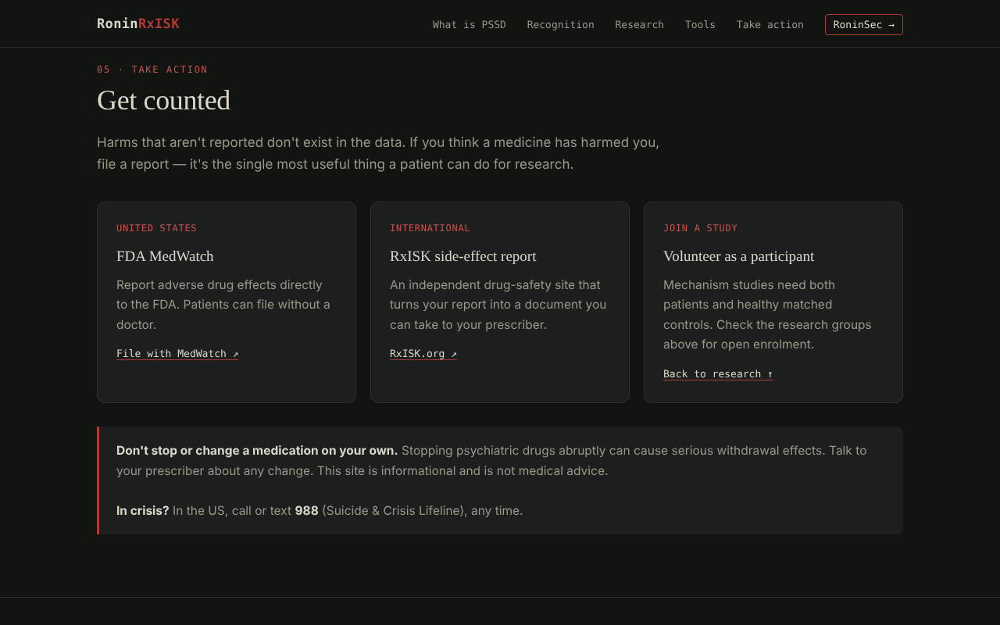
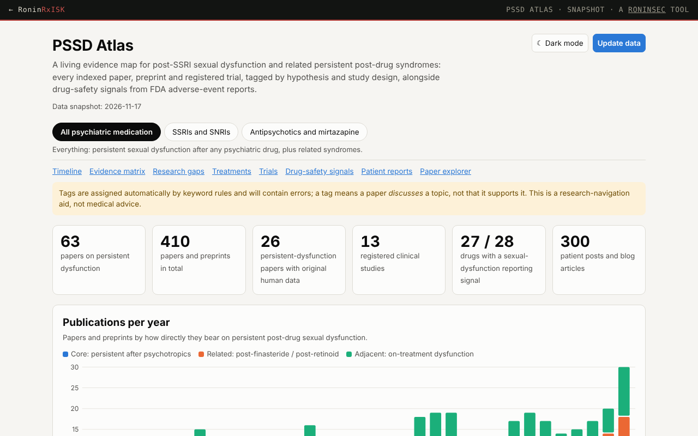
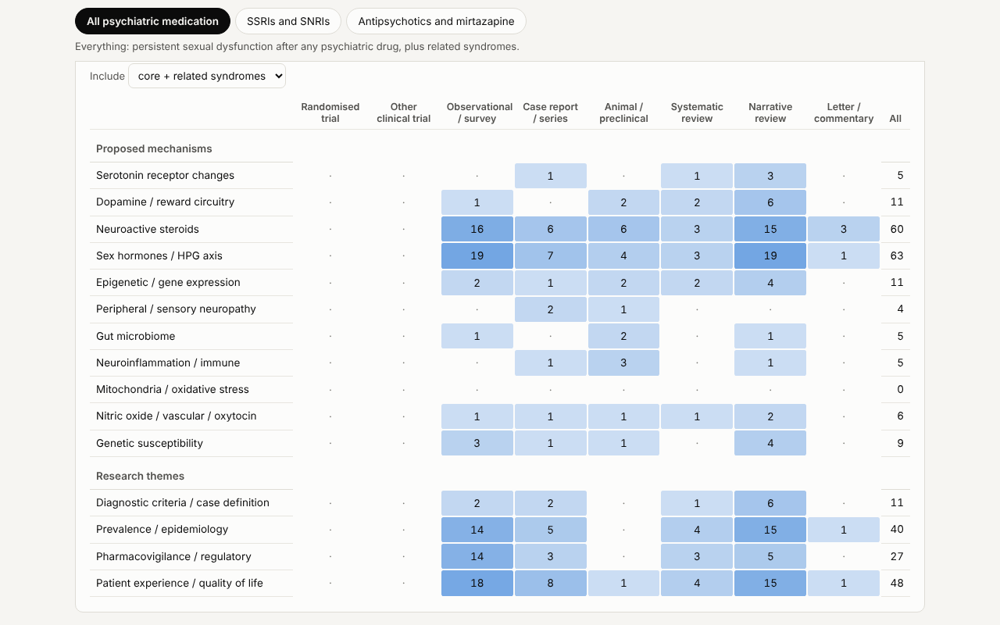
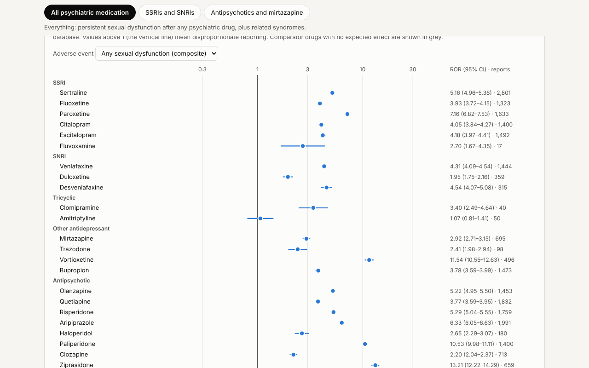

# RoninRxISK

Activism and advocacy: psychiatric medication harm and post-SSRI sexual dysfunction (PSSD) research. Tracks what is known, who is researching it, RoninSec research tools, and how patients can report harms.

Independent project, not affiliated with RxISK.org.

A [RoninSec](https://r0n1n9.github.io/roninsec/) brand. Live at https://r0n1n9.github.io/roninrxisk/



## What's on the site

The main page has five numbered sections:

1. **What is PSSD?** Symptoms, related conditions (PFS and PRSD), the open question of prevalence, and why it's a disclosure problem.
2. **Disclosure timeline:** from forum reports in the 1990s to the medical literature, the US fluoxetine label, Lareb, DSM-5, the European Medicines Agency, published diagnostic criteria, and funded research and regulator review.
3. **Active efforts:** who is researching PSSD (diagnostic criteria, epidemiology, the PSSD Network & The Florey, UBC SHAPE grants, the RxISK Prize & Research Fund, the NZ Medsafe / MARC review), each linked to its primary source.
4. **RoninSec tools:** the PSSD Atlas evidence map.
5. **Take action:** how to report harms (FDA MedWatch, RxISK report, volunteering for studies), a medication safety note and a crisis line.

| Disclosure timeline | Who is researching PSSD |
| --- | --- |
|  |  |
| **Get counted** | |
|  | |

### PSSD Atlas snapshot

`atlas/` is a static snapshot of the PSSD Atlas evidence map. It has summary tiles, a publications-per-year timeline, a hypothesis-by-study-design evidence matrix, research gaps, candidate treatments, trials, FAERS drug-safety signals, patient reports and a searchable paper explorer with CSV export.

| Overview | Evidence matrix | Drug-safety signals |
| --- | --- | --- |
|  |  |  |

## Running locally

Single static `index.html`, no build step. `.nojekyll` tells GitHub Pages to serve it as-is.

```bash
python3 -m http.server 8000   # then open http://localhost:8000/ and /atlas/
```

## Pages

| Path | Page |
|---|---|
| `index.html` | RoninRxISK: PSSD overview, recognition timeline, research efforts, tools, how to report harms |
| `atlas/index.html` | Snapshot of the PSSD Atlas evidence map |

To refresh the Atlas, run `python -m pssd_atlas update` in the `pssd` repo, copy `docs/index.html` to `atlas/index.html`, and re-add the RoninRxISK bar after `<body>`.
